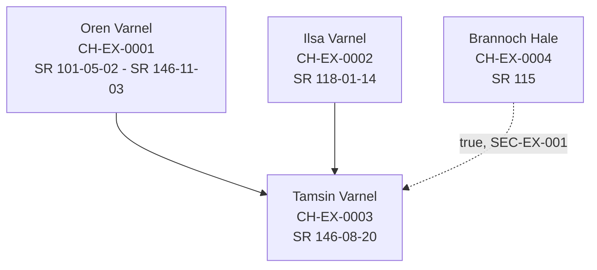

# Genealogy — format

Bloodlines are **not** stored in this folder by hand. They are built from the character records (one fact — one place):

| Field (in `characters/*.md`) | Meaning |
|---|---|
| `father`, `mother` | Official parents — what the world believes |
| `true_father`, `true_mother` | Real parents, only when different; requires `parentage_secret: SEC-…` |
| `adoptive_parents` | Wards, fosterlings, adoption |
| `house` | Current house (a woman marrying into another house changes `house`; the marriage itself is a `spouse` relation and, if politically important, an event) |
| `relations: [CH-…:spouse]` | Marriages; date of marriage, if it matters, is an event in `timeline.md` |

Why this way: one place for parentage, machine-checkable (cycles, impossible ages, parent dead long before birth), and both the *public* and the *true* tree can be produced from the same data — which is exactly what the mysteries need.

## Drawing a tree

```text
python3 studio/canon/tools/validate.py --mermaid HS-007              # public tree
python3 studio/canon/tools/validate.py --mermaid HS-007 --spoilers   # with secret parentage (dashed)
```

The output is a Mermaid `flowchart` that renders in GitHub, most Markdown viewers and mermaid.live. Generated trees may be saved here as `HS-NNN-tree.md` for reading, but they are **outputs**: regenerate, never edit by hand. Each saved tree states the canon version it was generated from.

For the audience (marketing, wiki-like materials) only the public tree is used, and only with facts already aired.

## Automatic checks

- no person is their own ancestor (cycle over official, true and adoptive links);
- a parent is born before the child; warning if a parent would be under 12;
- a mother is alive at the birth; a father died no more than one year before it;
- `true_*` parent requires a registered secret;
- every referenced ID exists.

## EXAMPLE output (generated from the EXAMPLE records, `--examples --mermaid HS-EX-001 --spoilers`)

See the keeper's report of 2026-11-22 for the exact output; shape:


