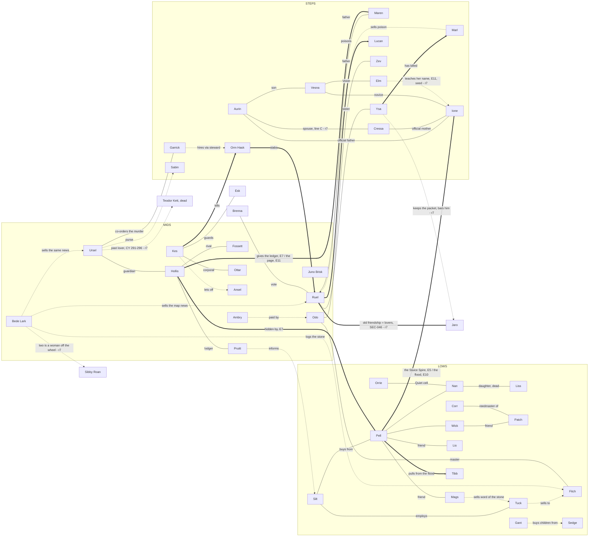

# Relationship map — Season 1 (*Dry Tithe*)

> **Revision r3 (lead-screenwriter, 2026-11-22 — rulings of `story/decisions_resolved.md`):** accepted as a working sheet. Read with these rulings: the assassin is a Lantern Company man supplied by Rook Danner and paid through Garrick's steward (DEC-36); the fence is Tuck (DEC-57); the passes run Dunmore's clerk → quartermaster's office → Ansel Fray (DEC-55).

> **Revision r7 (writer-characters, 2026-11-22 — love lines; `story/romance_lines.md` §0–§3, §5; `decisions_resolved.md` DEC-71…76; `season01_outline.md` r7):** map and tables extended with the S1 love lines: **L1** Ruel — Jaro (lovers, proposed SEC-046; the audience learns it in E9), **L2** Maren — Hollis (seed only), **L5** Elm — Ione (seed only), **A** Ursel — Teodor (past), **B** Bede — Sibby Roan (new minor), **C** Aurin — Cressa. New §6 (love lines in S1) and §7 (age gate). Relation kinds `lover` / `beloved` / `suitor` / `betrothed` follow DEC-76 (keeper).

Version 1.0 · 2026-11-22 · author: writer-characters · Canon: v0.1 (+ world package r2) · Spoiler level: **internal**
State at **S1E12** unless an episode is given. Who-knows-what is a proposal for `secrets.md` `known_by` (the keeper decides). Sealed links are not drawn.

## 1. Map (Mermaid)

## 2. Who knows whom (first meeting on screen)
| Pair | First contact | How they see each other at S1 end |
|---|---|---|
| Pell — Ione | E5 (a silver mark to be guided) | strangers bound by two notes and a flood; Pell thinks Ione is "a robe that came back"; Ione owes Pell the steadied Spire and doesn't know it |
| Pell — Hollis | E7 (he falls into the Lows) | fugitive and host; uneasy friends |
| Pell — Fitch | E2 (his eye on her cord) | hunter and prey; she doesn't know his face yet |
| Hollis — Maren | E7 | conspirators; she trusts his columns, not him |
| Ione — Elm | E3 (as the Voice), E11 (as a teacher) | the first person who speaks to her after the voice is gone |
| Kes — Esk | before S1; E4 on screen | sergeant and hostage; becoming family |
| Kes — Ruel | E2 (the quay) / E8 (the Steps) | she kills his assassin and cannot save him |
| Ruel — Ione | E4 (she carries his messages) | she sees his hinge; he sees a girl who looks at the Lows |
| Odo — Zev | always | love that cannot touch |
| Ruel — Jaro (r7) | since CY 305; on screen E4 | lovers under "an old friendship of sailors"; Ruel keeps the crime and the ring from him; Jaro is left with a lamp to put out (E9) |
| Ysa — Jaro (r7) | before S1; E9 | she has always known; she bars him, then lets him in last |
| Bede — Sibby (r7) | before S1 (four years of saving) | he is buying her off the wheel with the double sale; she is a back on the wheel (E7) |
| Ursel — Hollis | since CY 296 | guardian and ward; he thinks she saved him |
| Nan — Hollis | E7 | furious, then kind |
| Silt — Pell | before S1 | buyer and mudlark; Silt is fond of her and would sell her |

## 3. Who owes whom
| Debtor | Creditor | What | Pays |
|---|---|---|---|
| House Corvane (Ruel) | Lantry | the fleet refit | S2 (the war), S6 (crash) |
| the Choir | Lantry | "its roof" | S1E7–E12 (the vote) |
| Fennick | Lantry | loyalty, credit | S1E12 (the Ninth "reclaimed") |
| Dask (Garrick) | Lantry | grain-futures | S1E4 → S2 |
| Ninth Sluice | Fennick | the dry-tithe | S1E10 (they paid; the Spire was not sung) |
| Pell | Ione | her district (E10) | S4 (the duet) |
| Ione | Pell | the low hum that held the Spire (E10) — neither knows | S4 |
| Hollis | Ursel | his life since CY 296 | S6E8 (the bill comes in reverse) |
| Patch | Gant (the Undertow) | a debt he never made | S4E2–E6 |
| Kes | the Ninth | CY 295 | S1E10 (opens the gate), S3E9 |
| Ruel | Bede Lark | forty-mark news | S1E1 (the Helm's death) |
| Sibby Roan (r7) | the wheel (her dead husband's debt) | six years of steps; the bond Bede buys with two sales | S1 → S2E6 |
| Jaro (r7) | Ruel | his alibi — he will not sell it (E9) | the Quell frame holds until S2E11 |
| Maren | Ysa | the Corvane vote "on one condition" | S2E11 |
| Odo | Vesna | the Sunken Vote | S2–S5 |
| Ansel Fray | Kes | his neck ("next flood I'll hang you") | S1E10 → S3 (proposal) |
| Mags | Pell | a copper's worth of betrayal (proposal) | S2 (after Mags is dead) |

## 4. Who lies to whom
| Liar | To | The lie | Exposed |
|---|---|---|---|
| Ruel | everyone (Maren most) | the Helm died a natural death; "I don't drink before a storm" | S1E11 (Maren, Hollis, audience); public S6 |
| Ursel | Hollis | his father "drowned"; she is his benefactor | S6E8 |
| Ursel, Garrick | the Conclave | the assassin was Quell's (token) | S2E11 |
| Ysa | Maren | arrived "by the night barge"; her "condition" | S2E10–E11 |
| Odo | Vesna | says nothing of the wrong-ringing girl | (his own coin) |
| Vesna (via Elm) | Ione | the Choir's vote is about faith | S1E8 ("the Choir owes the bank its roof") |
| Elm | Vesna's listeners | softens her signs | S7E7 (Daro), S8E8 |
| the Ilvane house | Ione | she is Cressa's daughter; her hair is silver | S4E10 |
| Nan | Pell | "Oshra means nothing"; "your sister — the water took her" | S3E10, S4E10, S5E10 (in steps) |
| Kes | everyone | she was never at the Ninth's gate | S3E9 |
| Sabin | the Choir | the Spire "could not be retuned" | S2E6 |
| Sedge | the Choir | "returned" children went home | S4E6 |
| Fossett | Hollis | rival only, not Ursel's spy | S2E7 |
| Nell | Maren | Gullmouth-born | S9E7 |
| Fitch | the Listeners | his Lows birth (proposal) | S5 (proposal) |
| Dakka, Tsura | the Concord | Esk is a nephew | S7E6 |
| Pell | Nan | she has stopped humming outside | S2E3 (the slap) |
| Ruel and Jaro (r7) | everyone | "an old friendship of sailors" | S1E9 (audience; Ysa always knew); S2E10 (Maren) |
| Ruel (r7) | Jaro | the poison — he tells his sister, not his lover | S6E7–E8 (the unsent note of Longdark 5) |
| Jaro (r7) | the Ring | "On a deck. Waiting on the weather." — true and incomplete | S1E9 (audience, by E8's lamp shot) |
| Ysa (r7) | Maren | the packet in tarred twine is "evidence of the poison" | S2E10 ("There were two things to bury.") |
| Ursel (r7) | Hollis | the clip is "for a clerk who is trusted" — it was his father's | S6E8 |

## 5. The S1 vote (who votes how, and why)
| Vote | Cast by | For | Why |
|---|---|---|---|
| Corvane | Maren (after Ysa's condition) | Corvane | her father's cause |
| Quell | Jaro | Corvane | sailors; wreckers' money in Corvane's refit (proposal SEC-031); r7: Ruel (SEC-046) — *"Calm is bought. This one was paid for."* |
| Ilvane | Aurin (defying his mother, at Ione's signed request) | Corvane | Ione |
| Rusk | Brenna | Corvane | honour; dislike of the Listeners |
| Fennick | Odo | Fennick | — |
| Lantry | Ursel | Fennick | the Ninth "reclaimed" |
| the Choir | Vesna | Fennick | "the Choir owes the bank its roof" |
| Dask | Garrick | Fennick | bread; Ursel; Ruel's death |
| Sunken Vote | Vesna (speaker for the drowned) | **Fennick** | five taps |

## 6. Love lines in S1 (Revision r7)
Every S1 beat is staged on hands, lamps and backs (romance_lines §0.7); about three minutes over the season; no death, reveal, vote or cliffhanger moves (DEC-74).

| Line | Pair | Kind in S1 | Episodes (S1) | Who knows at S1 end | Pays |
|---|---|---|---|---|---|
| L1 "The Second Lamp" | Ruel (48) — Jaro (36) | **lovers** (secret, proposed SEC-046) | E4 lamp & hand · E6 corridor · E8 two lamps, a man waiting · E9 barred, the packet, the wake, the alibi line · E12 the vote line, hulls astern | Ysa (always); the audience (E9); Ione saw two lamps (E4) without knowing | S2E10 (Maren), S2E11 (Odo's blackmail) |
| L2 "The Clerk and the Admiral" | Maren (19) — Hollis (26) | **seed only**, not romantic | E7 "a house on the Steps" · E11 "Twice, by now" | — | S2 letters; S4E12 the first kiss |
| L5 "The Voice" | Elm (22) — Ione (18) | **seed only**, not romantic | E11 the first sign: her name; he never speaks aloud | — | S2 lessons; S4E10 |
| A "A Beautiful Hand" | Ursel — Teodor (dead CY 296) | past lovers (proposed SEC-050) | E1 the clip · E11 "a beautiful hand" + the empty sleeve | Ursel only | S4E6 "U. —"; S6E8 |
| B "Twice" | Bede (40) — Sibby Roan (33) | his reason (proposed SEC-051) | E7 "two is a woman off the wheel" (her back on Corr's wheel) | Bede | S2E4, S2E6 |
| C "The Other Thing" | Aurin (44) — Cressa (40) | marriage of courtesy | E3 he stands in the door at the rinse | — | S5 the rolls; S6E12 |

## 7. Age gate (DEC-71) — S1 cast
- **Romance allowed in S1:** only between characters who are 18+ in CY 312 — in practice the lines above.
- **No romance, no hint, no "almost" in S1–S4:** Pell (15), Esk (13), Zev (14), Lio (17). Pell and Lio are friends of 15 and 17 and nothing else; Pell and Esk never meet in S1–S4.
- **Never romantic at any age:** Wick, Tibb, Mags, Patch, Daro Vey (romance_lines §0.3; Sindre and Ylva are outside this sheet). Kes and Esk are **guardian and ward — family**. Jaro's protection of Lio (S2–S6) is **patronage only**.
- **No retroactive framing:** a feeling that begins in an adult season is never dated back to childhood.
