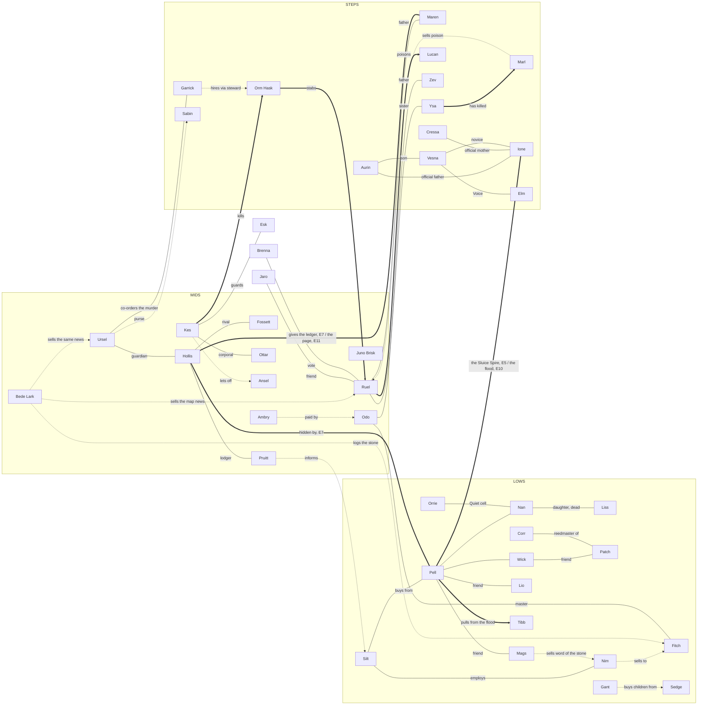

# Relationship map — Season 1 (*Dry Tithe*)

Version 1.0 · 2026-11-22 · author: writer-characters · Canon: v0.1 (+ world package r2) · Spoiler level: **internal**
State at **S1E12** unless an episode is given. Who-knows-what is a proposal for `secrets.md` `known_by` (the keeper decides). Sealed links are not drawn.

## 1. Map (Mermaid)

## 2. Who knows whom (first meeting on screen)
| Pair | First contact | How they see each other at S1 end |
|---|---|---|
| Pell — Ione | E5 (a silver mark to be guided) | strangers bound by two notes and a flood; Pell thinks Ione is "a robe that came back"; Ione owes Pell the steadied Spire and doesn't know it |
| Pell — Hollis | E7 (he falls into the Lows) | fugitive and host; uneasy friends |
| Pell — Fitch | E2 (his eye on her cord) | hunter and prey; she doesn't know his face yet |
| Hollis — Maren | E7 | conspirators; she trusts his columns, not him |
| Ione — Elm | E3 (as the Voice), E11 (as a teacher) | the first person who speaks to her after the voice is gone |
| Kes — Esk | before S1; E4 on screen | sergeant and hostage; becoming family |
| Kes — Ruel | E2 (the quay) / E8 (the Steps) | she kills his assassin and cannot save him |
| Ruel — Ione | E4 (she carries his messages) | she sees his hinge; he sees a girl who looks at the Lows |
| Odo — Zev | always | love that cannot touch |
| Ursel — Hollis | since CY 296 | guardian and ward; he thinks she saved him |
| Nan — Hollis | E7 | furious, then kind |
| Silt — Pell | before S1 | buyer and mudlark; Silt is fond of her and would sell her |

## 3. Who owes whom
| Debtor | Creditor | What | Pays |
|---|---|---|---|
| House Corvane (Ruel) | Lantry | the fleet refit | S2 (the war), S6 (crash) |
| the Choir | Lantry | "its roof" | S1E7–E12 (the vote) |
| Fennick | Lantry | loyalty, credit | S1E12 (the Ninth "reclaimed") |
| Dask (Garrick) | Lantry | grain-futures | S1E4 → S2 |
| Ninth Sluice | Fennick | the dry-tithe | S1E10 (they paid; the Spire was not sung) |
| Pell | Ione | her district (E10) | S4 (the duet) |
| Ione | Pell | the low hum that held the Spire (E10) — neither knows | S4 |
| Hollis | Ursel | his life since CY 296 | S6E8 (the bill comes in reverse) |
| Patch | Gant (the Undertow) | a debt he never made | S4E2–E6 |
| Kes | the Ninth | CY 295 | S1E10 (opens the gate), S3E9 |
| Ruel | Bede Lark | forty-mark news | S1E1 (the Helm's death) |
| Maren | Ysa | the Corvane vote "on one condition" | S2E11 |
| Odo | Vesna | the Sunken Vote | S2–S5 |
| Ansel Fray | Kes | his neck ("next flood I'll hang you") | S1E10 → S3 (proposal) |
| Mags | Pell | a copper's worth of betrayal (proposal) | S2 (after Mags is dead) |

## 4. Who lies to whom
| Liar | To | The lie | Exposed |
|---|---|---|---|
| Ruel | everyone (Maren most) | the Helm died a natural death; "I don't drink before a storm" | S1E11 (Maren, Hollis, audience); public S6 |
| Ursel | Hollis | his father "drowned"; she is his benefactor | S6E8 |
| Ursel, Garrick | the Conclave | the assassin was Quell's (token) | S2E11 |
| Ysa | Maren | arrived "by the night barge"; her "condition" | S2E10–E11 |
| Odo | Vesna | says nothing of the wrong-ringing girl | (his own coin) |
| Vesna (via Elm) | Ione | the Choir's vote is about faith | S1E8 ("the Choir owes the bank its roof") |
| Elm | Vesna's listeners | softens her signs | S7E7 (Daro), S8E8 |
| the Ilvane house | Ione | she is Cressa's daughter; her hair is silver | S4E10 |
| Nan | Pell | "Oshra means nothing"; "your sister — the water took her" | S3E10, S4E10, S5E10 (in steps) |
| Kes | everyone | she was never at the Ninth's gate | S3E9 |
| Sabin | the Choir | the Spire "could not be retuned" | S2E6 |
| Sedge | the Choir | "returned" children went home | S4E6 |
| Fossett | Hollis | rival only, not Ursel's spy | S2E7 |
| Nell | Maren | Gullmouth-born | S9E7 |
| Fitch | the Listeners | his Lows birth (proposal) | S5 (proposal) |
| Dakka, Tsura | the Concord | Esk is a nephew | S7E6 |
| Pell | Nan | she has stopped humming outside | S2E3 (the slap) |

## 5. The S1 vote (who votes how, and why)
| Vote | Cast by | For | Why |
|---|---|---|---|
| Corvane | Maren (after Ysa's condition) | Corvane | her father's cause |
| Quell | Jaro | Corvane | sailors; wreckers' money in Corvane's refit (proposal SEC-031) |
| Ilvane | Aurin (defying his mother, at Ione's signed request) | Corvane | Ione |
| Rusk | Brenna | Corvane | honour; dislike of the Listeners |
| Fennick | Odo | Fennick | — |
| Lantry | Ursel | Fennick | the Ninth "reclaimed" |
| the Choir | Vesna | Fennick | "the Choir owes the bank its roof" |
| Dask | Garrick | Fennick | bread; Ursel; Ruel's death |
| Sunken Vote | Vesna (speaker for the drowned) | **Fennick** | five taps |
